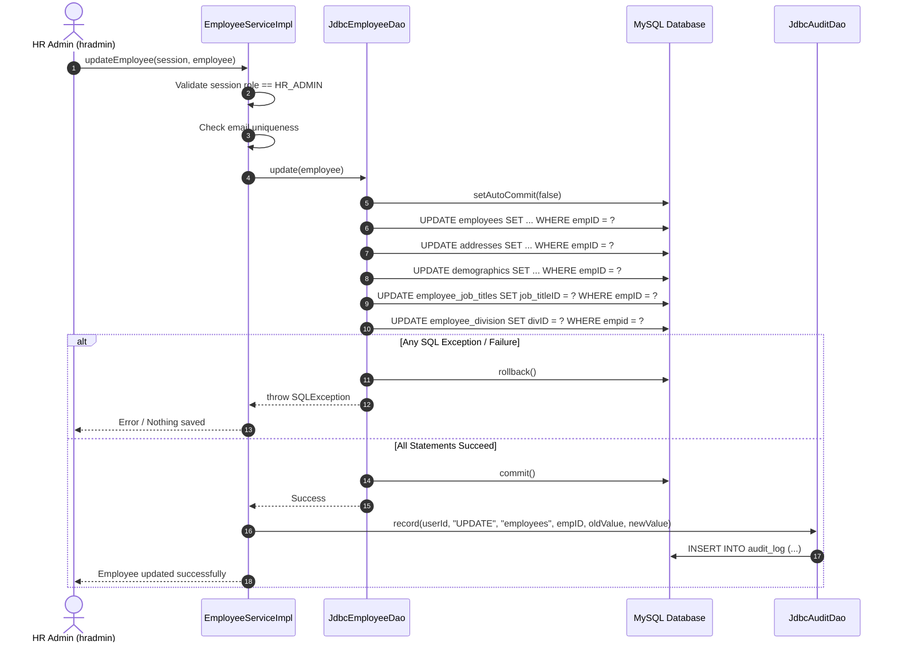

# Programming Task 4: Update Employee Data (Deliverable 2 - Task a / Feature 4) 
**Member 4 (Role: Update Employee)** 

## Part 1: Programming Task Specification (PT-4)

### 1. Task Overview & Objective
This task implements **Feature 4 (Task a)** of the Company Z Employee Management System as required by Deliverable Item 2: **Update employee data**. It provides a generalized, comprehensive update mechanism that saves all employee attributes across the normalized database schema in a single atomic transaction.

Once an HR Administrator selects an employee from the search result list (implemented by Member 2), the system allows modifying any profile attributes. The update operation covers core employment fields, physical address information, demographic/contact details, and organizational job title and division assignments.

### 2. Security & Role-Based Authorization
- **Authorized Role:** `HR_ADMIN` only.
- **Unauthorized Roles:** General `EMPLOYEE` (e.g., `sbeagle`) or unauthenticated users.
- **Enforcement Policy:** 
  The service layer checks the caller's active session (`Session.getRole()`).
  - If the role is NOT `Role.HR_ADMIN`, the system immediately throws `AccessDeniedException("Access denied: HR_ADMIN privilege required to update employee records.")`.
  - The transaction is never initiated, and no database query or update executes.

### 3. Architecture & Class Design

#### 3.1 Domain Model Classes
To ensure clean cohesion and adherence to Third Normal Form (3NF), employee data is represented by three modular domain model classes:

1. **`com.companyz.ems.model.Employee`**
   - `int empId`: Unique employee identifier (Primary Key).
   - `String firstName`: First name (`Fname`, `VARCHAR(65)`).
   - `String lastName`: Last name (`Lname`, `VARCHAR(65)`).
   - `String email`: Corporate email address (`email`, `VARCHAR(65)`, must be unique).
   - `LocalDate hireDate`: Date of hire (`HireDate`, `DATE`).
   - `BigDecimal salary`: Annual compensation (`Salary`, `DECIMAL(10,2)`).
   - `String ssn`: Social Security Number (`SSN`, `VARCHAR(12)`).
   - `Address address`: Associated residential address entity.
   - `Demographics demographics`: Associated personal and emergency demographic entity.
   - `int jobTitleId`: Foreign key to `job_titles` via `employee_job_titles`.
   - `int divisionId`: Foreign key to `division` via `employee_division`.

2. **`com.companyz.ems.model.Address`**
   - `int addressId`: Unique address identifier (`addressID`, Primary Key).
   - `int empId`: Foreign key to `employees(empID)`.
   - `String street`: Street address line (`street`, `VARCHAR(100)`).
   - `int cityId`: Foreign key to `cities(cityID)`.
   - `int stateId`: Foreign key to `states(stateID)`.
   - `String zip`: Postal code (`zip`, `VARCHAR(15)`).

3. **`com.companyz.ems.model.Demographics`**
   - `int empId`: Foreign key and Primary Key referencing `employees(empID)`.
   - `LocalDate dateOfBirth`: Date of birth (`DOB`, `DATE`).
   - `String mobilePhone`: Employee primary contact number (`mobile`, `VARCHAR(20)`).
   - `String emergencyContactName`: Primary emergency contact (`emergency_contact_name`, `VARCHAR(100)`).
   - `String emergencyContactMobile`: Emergency contact phone (`emergency_contact_mobile`, `VARCHAR(20)`).

#### 3.2 Service Layer (`com.companyz.ems.service`)
- **Interface:** `EmployeeService`
- **Implementation:** `EmployeeServiceImpl`
- **Method Signature:**
  ```java
  public void updateEmployee(Session session, Employee employee) 
      throws AccessDeniedException, ValidationException, DatabaseException;
  ```
- **Responsibilities:**
  1. Validates that `session` is non-null, active, and has `session.getRole() == Role.HR_ADMIN`.
  2. Validates business constraints:
     - Null/empty checks on required fields (`Fname`, `Lname`, `email`, `SSN`, `salary`).
     - Checks email uniqueness: ensures `employee.getEmail()` is not currently assigned to any other employee (`empID != employee.getEmpId()`). If a conflict is found, throws `ValidationException("Email already in use")`.
  3. Retrieves the current state of the employee from the database to capture `oldValue` for auditing.
  4. Delegates persistence to `JdbcEmployeeDao.update(employee)`.
  5. Serializes old and new employee state representations and logs an `UPDATE` record via `JdbcAuditDao.record(...)`.

#### 3.3 Data Access Layer (`com.companyz.ems.dao`)
- **Interface:** `EmployeeDao`
- **Implementation:** `com.companyz.ems.dao.jdbc.JdbcEmployeeDao`
- **Method Signature:**
  ```java
  public void update(Employee employee) throws SQLException;
  ```
- **Constructor:**
  ```java
  public JdbcEmployeeDao(ConnectionFactory connectionFactory)
  ```
- **Responsibilities:**
  - Manages database connection and transaction boundary.
  - Executes parameterized updates using `PreparedStatement` on all five target tables.

### 4. Database Transaction Management & SQL Operations

All database modifications occur within a **single atomic transaction** on the shared MySQL database (`employeeData`).



#### 4.1 Transaction Boundary & Rollback Guarantee
```java
Connection conn = connectionFactory.getConnection();
try {
    conn.setAutoCommit(false);

    
    updateEmployeesTable(conn, employee);

    
    updateAddressesTable(conn, employee.getAddress());

   
    updateDemographicsTable(conn, employee.getDemographics());

    
    updateJobTitleTable(conn, employee.getEmpId(), employee.getJobTitleId());

    
    updateDivisionTable(conn, employee.getEmpId(), employee.getDivisionId());

    conn.commit();
} catch (SQLException e) {
    conn.rollback();
    throw new DatabaseException("Failed to update employee. Transaction rolled back.", e);
} finally {
    conn.setAutoCommit(true);
    conn.close();
}
```

#### 4.2 PreparedStatements Executed
1. **Uniqueness Pre-Check (`employees`):**
   ```sql
   SELECT empID FROM employees WHERE email = ? AND empID != ?;
   ```
2. **Core Employee Record (`employees`):**
   ```sql
   UPDATE employees 
   SET Fname = ?, Lname = ?, email = ?, HireDate = ?, Salary = ?, SSN = ? 
   WHERE empID = ?;
   ```
3. **Address Record (`addresses`):**
   ```sql
   UPDATE addresses 
   SET street = ?, cityID = ?, stateID = ?, zip = ? 
   WHERE empID = ?;
   ```
4. **Demographics Record (`demographics`):**
   ```sql
   UPDATE demographics 
   SET DOB = ?, mobile = ?, emergency_contact_name = ?, emergency_contact_mobile = ? 
   WHERE empID = ?;
   ```
5. **Job Title Association (`employee_job_titles`):**
   ```sql
   UPDATE employee_job_titles 
   SET job_titleID = ? 
   WHERE empID = ?;
   ```
6. **Division Association (`employee_division`):**
   ```sql
   UPDATE employee_division 
   SET divID = ? 
   WHERE empid = ?;
   ```

### 5. Audit Logging
Every successful update triggers a call to `AuditDao.record(...)`:
```java
auditDao.record(
    session.getUserId(),      
    "UPDATE",                 
    "employees",            
    employee.getEmpId(),      
    oldJsonState,             
    newJsonState              
);
```
SQL executed by `JdbcAuditDao`:
```sql
INSERT INTO audit_log (user_id, action, table_name, record_id, old_value, new_value, timestamp)
VALUES (?, 'UPDATE', 'employees', ?, ?, ?, NOW());
```

---

## Part 2: Test Case Specifications

All test cases utilize the standard shared test dataset:
- Baseline employees: `empID` 1 through 6
- Unused/non-existent employee ID: `empID = 9999`
- User Logins:
  - HR Admin: `hradmin` / `HrAdmin!2026` (Role: `HR_ADMIN`)
  - Employee: `sbeagle` / `Employee!2026` (Role: `EMPLOYEE`, `empID = 1`, Snoopy Beagle)

---

### Test Case TC-4.1: Successful Employee Demographics Update by HR Admin

- **Test ID:** TC-4.1
- **Feature / Task:** Update employee data (Feature 4, Task a)
- **Objective:** Verify that an authenticated HR Admin can update an existing employee's mobile phone number in the `demographics` table, commit the change in a single transaction, leave other fields unchanged, and generate an `UPDATE` audit log entry.
- **Actor / Session:** `hradmin` (authenticated, Role: `HR_ADMIN`, `userId = 100`)

#### Pre-conditions
1. Database contains employee record for `empID = 4` (Pepermint Patti).
2. Existing record values for `empID = 4`:
   - `employees`: `Fname='Pepermint'`, `Lname='Patti'`, `email='Peppermint@example.com'`, `Salary=98000.00`, `SSN='111-44-1111'`.
   - `demographics`: `mobile='470-555-0104'`.
3. `hradmin` is logged in with active `Session` containing `Role.HR_ADMIN`.

#### Input Data
- Target `empID`: `4`
- Field updated: `demographics.mobile_phone` = `"470-555-9999"`
- All other fields of `Employee`, `Address`, `Demographics`, `job_titleID` (200), and `divID` (2) are supplied with their current existing values.

#### Execution Steps
1. Authenticate user as `hradmin` / `HrAdmin!2026` to obtain a valid `Session`.
2. Retrieve the existing `Employee` object for `empID = 4` via `employeeService.searchForEditing(session, criteria)`.
3. Mutate the mobile number: `employee.getDemographics().setMobilePhone("470-555-9999")`.
4. Call `employeeService.updateEmployee(session, employee)`.

#### Expected Output & Database State
1. **Return Value:** Method completes normally with success confirmation.
2. **Database Verification:**
   - Query: `SELECT mobile FROM demographics WHERE empID = 4;`  
     **Result:** `'470-555-9999'`.
   - All other columns across `employees`, `addresses`, `employee_job_titles`, and `employee_division` for `empID = 4` remain exactly identical to their pre-test values.
3. **Audit Log Verification:**
   - Query: `SELECT * FROM audit_log WHERE table_name = 'employees' AND record_id = 4 AND action = 'UPDATE' ORDER BY log_id DESC LIMIT 1;`  
     **Result:** Exactly one row present, where `user_id = 100`, `action = 'UPDATE'`, `record_id = 4`, `old_value` reflects the original mobile number, and `new_value` reflects `"470-555-9999"`.

#### Pass / Fail Criteria
- **PASS:** `demographics.mobile` equals `'470-555-9999'`, no other columns or employee records are altered, and exactly one matching `UPDATE` row exists in `audit_log`.
- **FAIL:** The mobile number does not update, an unhandled exception occurs, other employee fields are overwritten/corrupted, or the audit log row is absent.

---

### Test Case TC-4.2: Duplicate Email Validation & Transaction Rollback

- **Test ID:** TC-4.2
- **Feature / Task:** Update employee data - Duplicate email rejection and transaction rollback
- **Objective:** Verify that when an HR Admin attempts to change an employee's email address to one that is already assigned to another employee, the system rejects the operation with `"Email already in use"`, executes a complete rollback, and writes nothing to the database or audit log.
- **Actor / Session:** `hradmin` (authenticated, Role: `HR_ADMIN`)

#### Pre-conditions
1. Employee `empID = 1` exists with `email = 'Snoopy@example.com'`.
2. Employee `empID = 2` exists with `email = 'Charlie@example.com'`.
3. `hradmin` is logged in with active `Session` containing `Role.HR_ADMIN`.

#### Input Data
- Target `empID`: `2` (Charlie Brown)
- Field updated: `email` = `"Snoopy@example.com"` (duplicate of employee 1)
- Other fields: Retain current Charlie Brown values (`Fname='Charlie'`, `Lname='Brown'`, `Salary=48000.00`, etc.).

#### Execution Steps
1. Authenticate user as `hradmin` / `HrAdmin!2026`.
2. Retrieve the existing `Employee` object for `empID = 2`.
3. Set conflicting email: `employee.setEmail("Snoopy@example.com")`.
4. Call `employeeService.updateEmployee(session, employee)`.

#### Expected Output & Database State
1. **Return Value / Exception:** System throws `ValidationException` with error message `"Email already in use"`.
2. **Database Verification:**
   - Query: `SELECT email FROM employees WHERE empID = 2;`  
     **Result:** `'Charlie@example.com'` (unchanged).
   - Query: `SELECT email FROM employees WHERE empID = 1;`  
     **Result:** `'Snoopy@example.com'` (unchanged).
   - Zero changes made to `employees`, `addresses`, `demographics`, `employee_job_titles`, or `employee_division`.
3. **Audit Log Verification:**
   - Query: `SELECT COUNT(*) FROM audit_log WHERE record_id = 2 AND action = 'UPDATE' AND timestamp >= <test_start_time>;`  
     **Result:** `0` (no audit row created for rejected operation).

#### Pass / Fail Criteria
- **PASS:** System rejects update with exact message `"Email already in use"`, Charlie Brown's email remains `'Charlie@example.com'`, no partial database writes occur, and no audit row is logged.
- **FAIL:** The duplicate email is saved, an unhandled database unique key constraint error crashes the application instead of a clean user message, or partial record updates persist.

---

### Test Case TC-4.3: Role-Based Authorization Denial (Employee Modifying Record)

- **Test ID:** TC-4.3
- **Feature / Task:** Update employee data - Role-based authorization enforcement
- **Objective:** Verify that a standard employee (`sbeagle`) is strictly denied permission to call `updateEmployee`, even on their own employee record, ensuring only HR Administrators can perform employee modifications.
- **Actor / Session:** `sbeagle` (authenticated, Role: `EMPLOYEE`, `empID = 1`)

#### Pre-conditions
1. User `sbeagle` is authenticated with active `Session` containing `Role.EMPLOYEE` and `empID = 1`.
2. Employee 1 record exists: `Fname='Snoopy'`, `Lname='Beagle'`, `Salary=45000.00`.

#### Input Data
- Caller Session: `sbeagle` (`Role.EMPLOYEE`)
- Target `empID`: `1`
- Attempted modification: `salary` = `60000.00` or `mobile` = `"470-555-1234"`

#### Execution Steps
1. Authenticate user as `sbeagle` / `Employee!2026`.
2. Obtain or construct an `Employee` object representing modified data for `empID = 1`.
3. Call `employeeService.updateEmployee(session, employee)`.

#### Expected Output & Database State
1. **Return Value / Exception:** System throws `AccessDeniedException` with message `"Access denied"`.
2. **Database Verification:**
   - Query: `SELECT Salary FROM employees WHERE empID = 1;`  
     **Result:** `45000.00` (unchanged).
   - No rows modified in `employees`, `addresses`, `demographics`, `employee_job_titles`, or `employee_division`.
3. **Audit Log Verification:**
   - No `UPDATE` row added to `audit_log` for `empID = 1`.

#### Pass / Fail Criteria
- **PASS:** Call is rejected with `"Access denied"`, zero database changes occur, and zero audit log entries are generated.
- **FAIL:** The update executes successfully, or any data is modified by a non-`HR_ADMIN` role.

